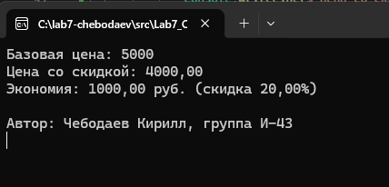
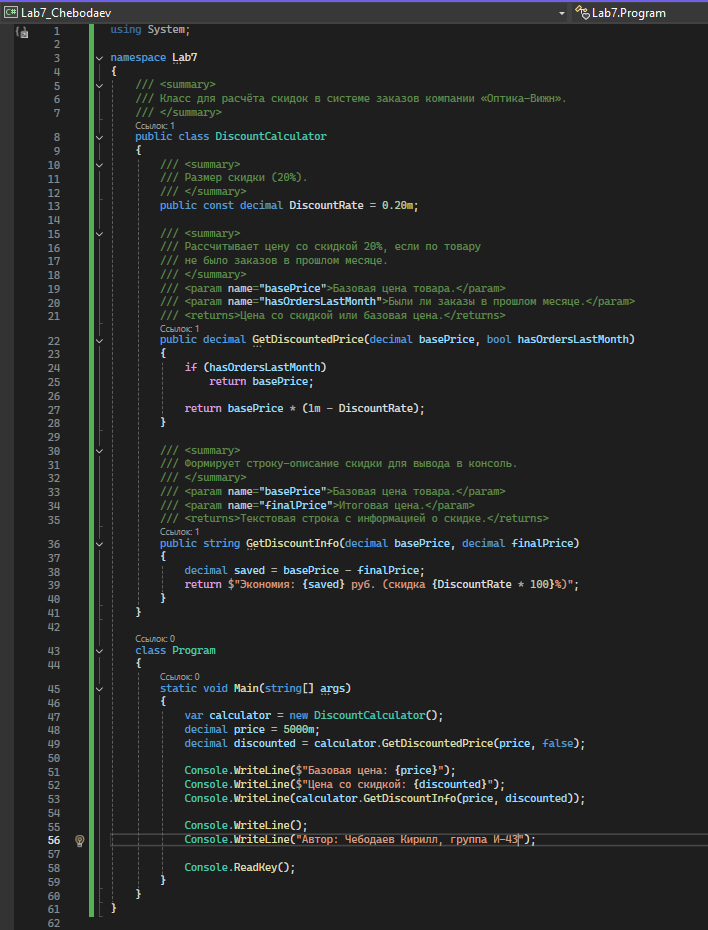
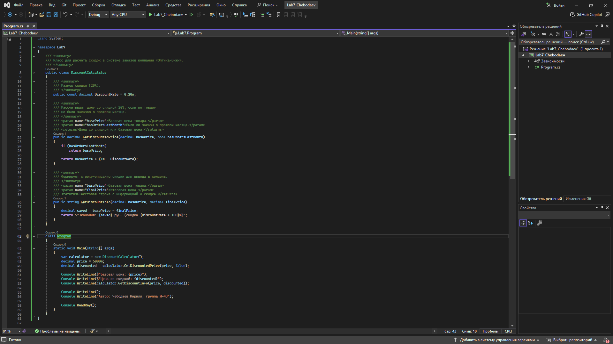

\# Система заказов компании «Оптика-Вижн»

\*\*Автор:\*\* Чебодаев Кирилл, группа И-43

\## Что делает программа

\- Рассчитывает цену со скидкой 20% для товаров без заказов в прошлом месяце

\- Выводит базовую цену, цену со скидкой и размер экономии в консоль

\- Демонстрирует работу метода `GetDiscountedPrice`

\## Как запустить

1\. Открыть файл `src/Lab7_Chebodaev.sln` в Visual Studio 2022

2\. Нажать F5

3\. В консоли появится результат расчёта

\## Скриншоты

\### Скриншот 1: Результат работы программы

\### Скриншот 2: XML-комментарии в коде

\### Скриншот 3: Среда разработки

